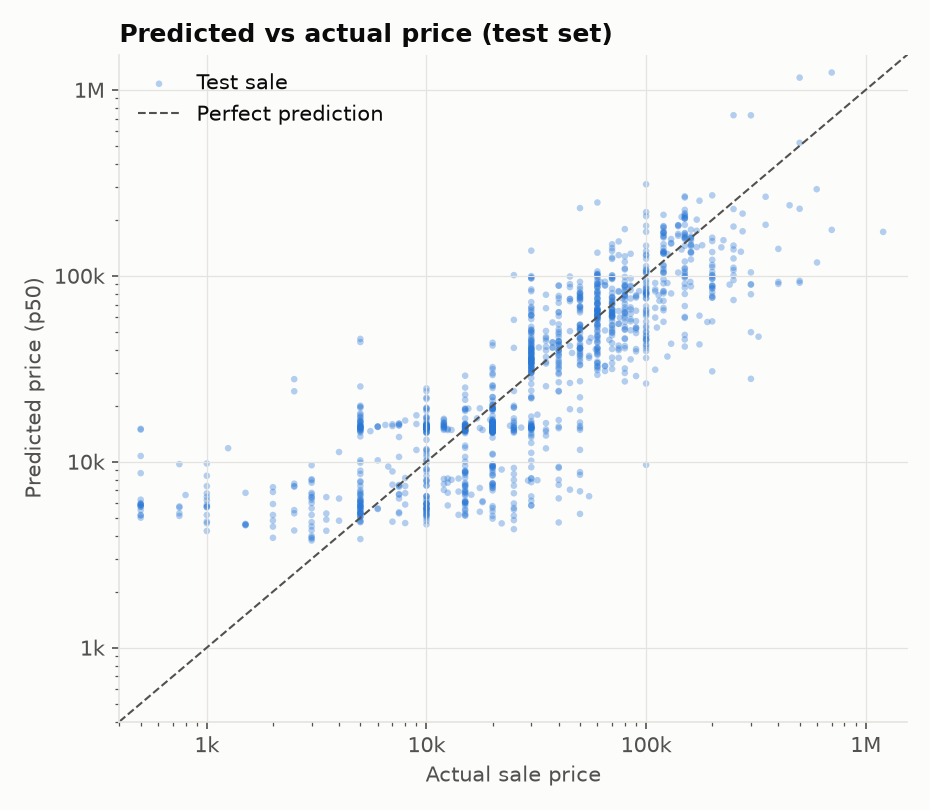
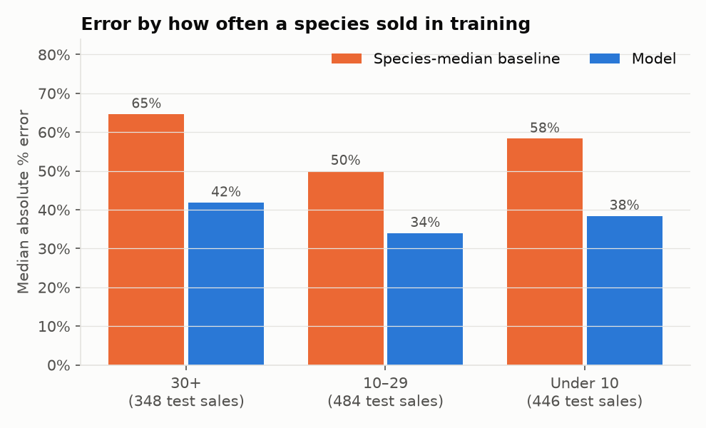
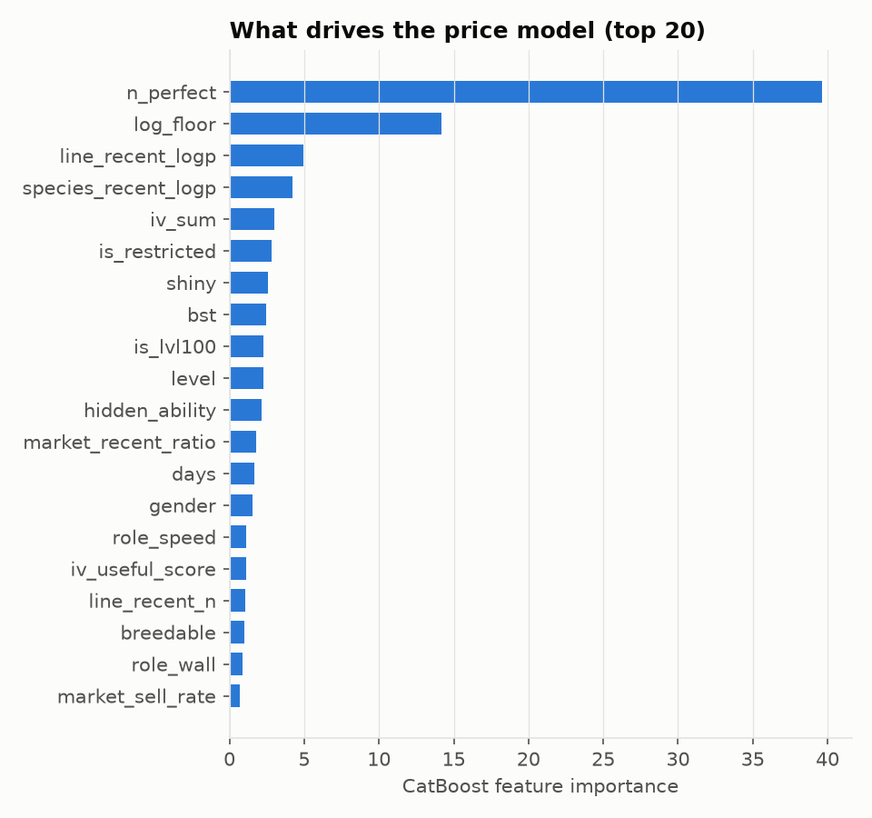
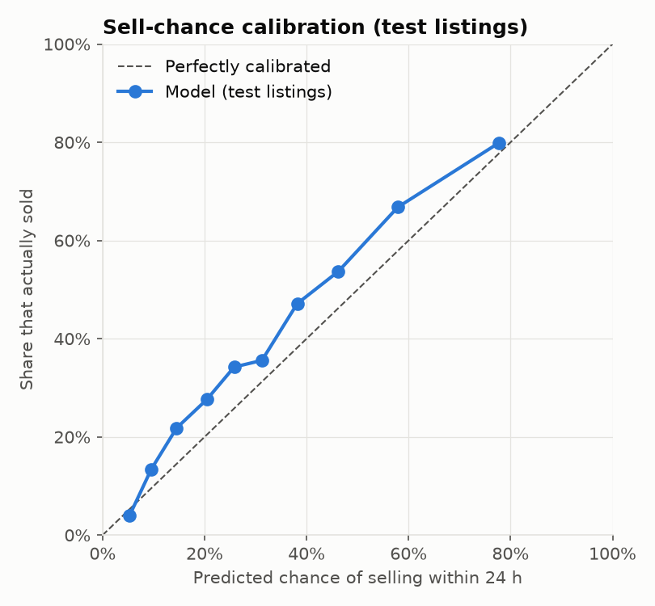
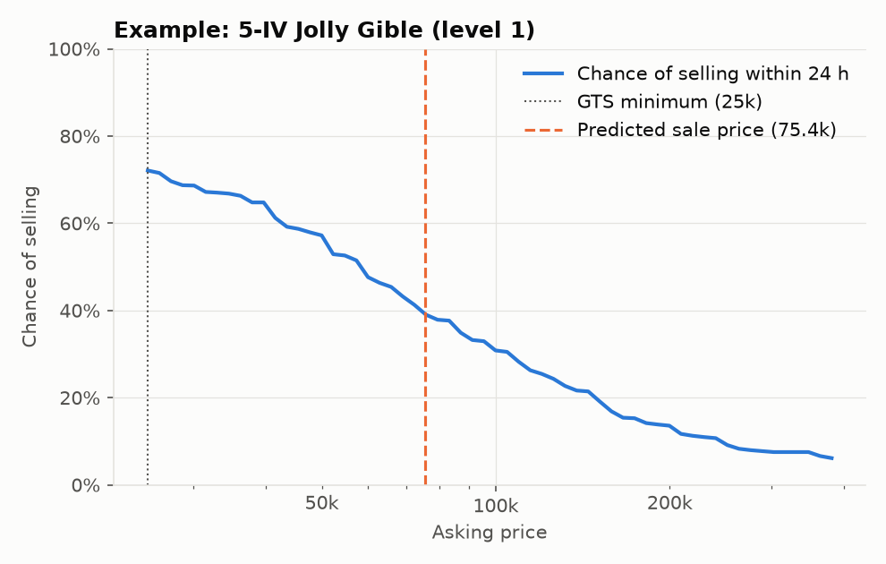
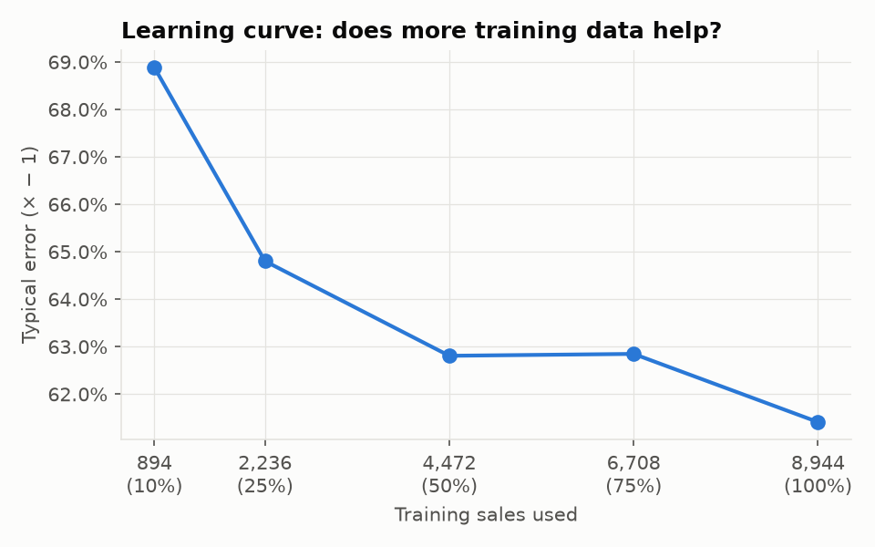
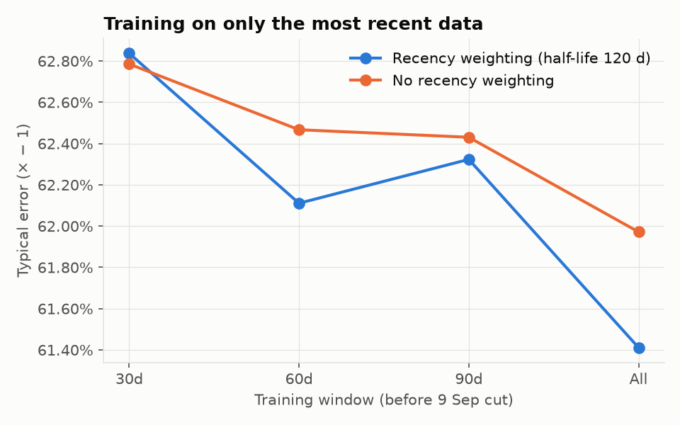
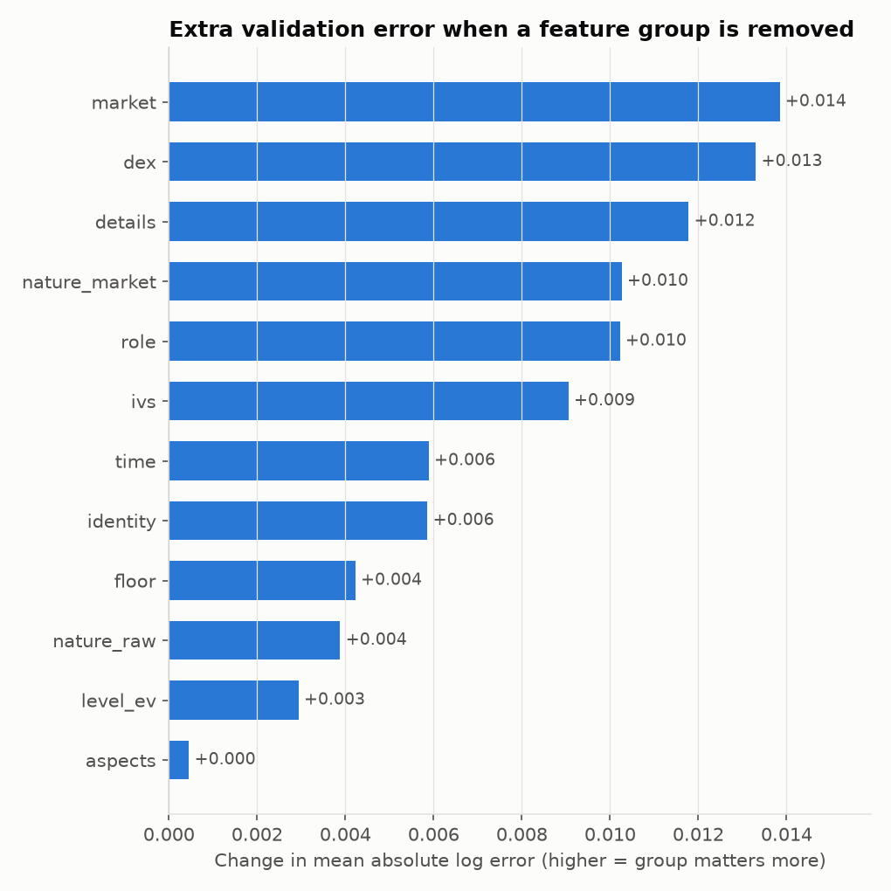

# Results

All numbers come from `model/artifacts/metrics.json` (final model) and `metrics_v1.json` (the
first version). The **test set** is the last 10% of sales by time: 1,278 sales from 21 Oct to
18 Nov 2026 (2,978 listings for the sell-chance model). It played no part in training or tuning.
It was looked at once after v1 and once for the final model (see [tuning.md](tuning.md)).

## Price model (Model A)

| Test set | Guess overall median | Guess the GTS floor | Guess species median | **Model v1** | **Final model** |
|---|---|---|---|---|---|
| Median % error | 71% | 70% | 58% | 36.9% | 37.7% |
| Mean absolute log error | 1.087 | 1.482 | 0.806 | 0.555 | **0.535** |
| Typical miss (× either way) | ×2.97 | ×4.40 | ×2.24 | ×1.74 | **×1.71** |
| Within ±25% | 13% | 14% | 25% | 35.8% | 34.6% |
| Within ±50% | 34% | 27% | 46% | 62.5% | **63.7%** |
| Actual price inside the p25–p75 range (target 50%) | n/a | n/a | n/a | 32% | **50.5%** |
| Predictions below the GTS floor | | | | 0 | 0 |

**Reading it:**
- **The model is clearly better than any simple rule.** "This species usually sells for X" is off
  by 58% for a typical sale; the model is off by about 38%.
- **Final vs v1 is a modest gain.** The final model is better on average (log error 0.535 vs 0.555)
  and on the share of sales within ±50%, and about the same on the median % error.
- **The real improvement is the range.** It now catches half of actual prices, as intended, where
  v1's caught a third. That's because v1's range was too narrow: prices drift between training and
  later periods. Before widening, the final model's raw range caught 38%. The ×1.35 stretch was
  chosen on validation and holds on test.
- **A typical miss of ×1.7** means a Pokémon that sells for 50k is typically predicted somewhere
  between about 29k and 85k. For individual species with plenty of history the model does much
  better (below).

The cluster along the bottom left is the floor dumps and very cheap sales: the actual price is
500–5k, but the model expects 5–15k. Those sellers chose to dump, which isn't visible in the
Pokémon's stats.

### Common vs rare species

| Species' sales in training | Test sales | Model median % error | Species-median guess | Range coverage |
|---|---|---|---|---|
| 30+ | 348 | 42% | 65% | 51% |
| 10–29 | 484 | 34% | 50% | 51% |
| Under 10 | 446 | 38% | 58% | 50% |

**Rare species do about as well as common ones.** That's what the Pokédex, role and evolution-line
features are for: a species with three sales borrows from similar species.

Oddly, the 30+ group does *worse*. Floor dumps don't explain it: that group has the fewest in the
test set (9.8%, against 14.5% for 10–29 and 8.5% for under 10). The likeliest cause is that the
most-traded species, such as Gible, Charmander, Ditto and the box legendaries, cover the widest
spread of quality, from 0-IV catches to 6-IV bred ones, so their prices vary most. This hasn't been
checked.

### Species that are getting accurate

For sales after the training period (validation and test together, species with at least 15 such
sales). These come from an intermediate single model (depth 4 with market features, before round 7
of tuning), so treat them as indicative:

| Species | Held-out sales | Median error | Within ±25% |
|---|---|---|---|
| Okidogi | 17 | 14% | 94% |
| Gible | 50 | 16% | 64% |
| Zorua | 18 | 18% | 56% |
| Tapu Koko | 21 | 19% | 57% |
| Cobalion | 18 | 21% | 67% |
| Suicune | 23 | 23% | 61% |
| Miraidon | 33 | 25% | 49% |
| … | | | |
| Eevee | 23 | 69% | 26% |
| Metagross | 18 | 72% | 6% |
| Gyarados | 26 | 585% | 8% (mostly dumped at 500–1,000) |

The good ones have steady, rule-like prices: a Gible's price follows its IVs and nature. The bad
ones depend on things the model can't see. For Eevee, it's which evolution the buyer has in mind.
For Gyarados, it's whether the seller is dumping.

### Shuffled split comparison

The same model on a **shuffled** 70/20/10 split scores a median error of 35.2% (log error 0.502),
against 37.7% (0.535) on the time-based split. A shuffled split lets the model learn from prices
after the ones it's tested on, which flatters it by about 2.5 points. The time-based split is the
honest one.

### What drives the price model

1. **Number of perfect IVs and the GTS floor.** The floor bundles perfect IVs with legendary,
   shiny and hidden-ability status.
2. **Recent prices of the same evolution line and species** (the 30-day market features from tuning).
3. **IV total, restricted-legendary status, shiny, base stat total, level 100, level, hidden ability.**

The role features (`role_speed`, `iv_useful_score`, `role_wall`) also make the top 20.

### Does the nature/role logic help? (validation set)

| Features | Validation error |
|---|---|
| No nature or role features | 0.4861 |
| + raw nature | 0.4898 |
| + role rule (`nature_fit`, role-weighted IVs/EVs) | 0.4890 |
| **+ learned market favourites (`line_nature`)** | **0.4788** |

- **The full set wins.** The raw nature label on its own adds nothing.
- **Nature pays off when it's tied to the Pokémon,** through the role rule and through each evolution
  line's learned favourites.
- **This is one run of each,** so differences under about 0.003 are noise (see [tuning.md](tuning.md)).
  The full set's lead of about 0.01 is real.

Spot checks with `predict.py` confirm the logic points the right way (same IVs, nature changed):

| Check | Result |
|---|---|
| Timid vs Adamant Charmander | 150k vs 132k ✓ |
| Adamant vs Modest Dratini | 148k vs 126k ✓ |
| Bold vs Mild Toxapex | 107k vs 99k ✓ |
| Timid vs Adamant Nihilego | 94k vs 83k ✓ |
| Brave vs Adamant Conkeldurr (Trick Room, shouldn't be penalised) | 56k vs 57k ✓ |
| Level 1 vs level 50 Gible, same IVs and nature | 75.4k vs 75.4k ✓ |
| Level 100 vs level 1 Rayquaza | 224k vs 212k ✓ |
| Level 100 Garchomp, 252 Atk/252 Spe vs no EVs | 278k vs 272k ✓ |
| 6-IV vs 0-IV Jolly Gible | 103k vs 10.7k ✓ |
| 6-IV vs random Ditto | 567k vs 31k ✓ |
| Rayquaza p25 never below the 30k legendary floor | 134k ✓ |

The nature gaps are smaller than the raw medians in [data.md](data.md), like Timid 80k vs Adamant 5k
for Charmander. That's expected: most of that raw gap is because breeders put their best IVs on
Timid, and here the IVs are held fixed.

## Sell-chance model (Model B)

| Test listings (38.4% sold within 24 h) | Overall sell rate | Price-gap only | **v1** | **Final** |
|---|---|---|---|---|
| AUC (0.5 = guessing) | 0.50 | 0.71 | 0.779 | 0.772 |
| Brier score (lower is better) | 0.238 | 0.213 | 0.192 | **0.190** |
| Log loss (lower is better) | 0.670 | 0.611 | 0.571 | **0.559** |
| Calibration error (avg gap, predicted vs actual) | 4.3 pts | 7.5 pts | 9.2 pts | **6.0 pts** |

- **Ranking:** given one listing that sold and one that didn't, the model rates the one that sold
  higher 77% of the time.
- **Probabilities:** they improved (log loss and calibration), mainly because the model now uses the
  recent market sell rate instead of the date.

**It's still a little pessimistic.** When it says 40%, about 47% sold. The test month (late Oct to
Nov) was busier than anything in training, and the sell rate rose from 28% in September to 40% in
November. The recent sell-rate feature tracks part of that, but not all. Read its percentages as
slightly conservative, and keep retraining as new data comes in.

### Example: how price trades off against selling

A 5-IV Jolly Gible (31/31/31/12/31/31, level 1):
- The GTS minimum is 25k. At that price, the chance of selling within 24 h is about 72%.
- At the model's estimated sale price (75k), the chance is about 40%.
- At 150k, it's about 20%.

`predict.py` turns this curve into a suggestion: the highest round price that still has at least a
60% chance (change it with `--target`). Here that's 40k. The trade-off is up to the seller: list
higher and wait, or list near 40k and sell today.

## Would more data help?

From `model/artifacts/experiments.json`, all on the validation set:
- the points below 100% are each averaged over 3 random subsamples
- single runs vary by about 0.003 between seeds, so gaps smaller than that are noise

### Amount of data: the learning curve

| Training sales | 894 (10%) | 2,236 (25%) | 4,472 (50%) | 6,708 (75%) | 8,944 (100%) |
|---|---|---|---|---|---|
| Mean abs log error | 0.524 | 0.500 | 0.487 | 0.488 | **0.479** |
| Typical miss | ×1.69 | ×1.65 | ×1.63 | ×1.63 | **×1.61** |
| Median % error | 38.3% | 35.3% | 33.9% | 34.3% | **32.1%** |

**More data still helps, but less each time.**
- Going from 10% to 50% of the data took the error from 0.524 to 0.487.
- Doubling again, from 50% to 100%, took it only to 0.479.
- The curve is flattening but hasn't stopped. A few more months of GTS logs should buy roughly
  another 0.005–0.01, about a 1-point drop in median % error.

Where more data will matter most is **the 580 species with fewer than 10 sales** and **rare forms
and cosmetics**. Each new sale of those adds real information, while another Gible sale adds very little.

### Age of data: is old data harmful?

| Training window (before the 9 Sep cut) | Recency-weighted (half-life 120 d) | Unweighted |
|---|---|---|
| Last 30 days (2,468 sales) | 0.4876 | 0.4873 |
| Last 60 days (5,406) | 0.4831 | 0.4853 |
| Last 90 days (8,085) | 0.4844 | 0.4851 |
| **Everything (8,944)** | **0.4788** | 0.4823 |

**Old data isn't harmful here, as long as it's down-weighted.**
- Throwing away anything older than 30–90 days made the model worse.
- Using all of it, with older sales counting for less, was best.
- The prices from June and July (when legendaries sold for about 115k) still teach the model a lot
  about *relative* value: which IVs, natures and forms are worth more. The recency weighting and the
  30-day market features take care of the *level* having moved.

This might change after a server wipe, an economy reset, or a GTS config change. Retraining on data
from after the change would then be the right move.

### Too many columns: does every feature group earn its place?

| Feature group removed | Validation error | Change | |
|---|---|---|---|
| (none, full model) | 0.4788 | | |
| Recent market | 0.4926 | +0.014 | matters most |
| Pokédex | 0.4921 | +0.013 | |
| Details (ability, HA, gender, ball, item) | 0.4906 | +0.012 | |
| Nature market favourites (`line_nature`) | 0.4890 | +0.010 | |
| Role (nature fit, role-weighted IVs/EVs) | 0.4890 | +0.010 | |
| IVs (raw) | 0.4878 | +0.009 | |
| Time | 0.4847 | +0.006 | |
| Identity (species, form, line) | 0.4846 | +0.006 | |
| GTS floor | 0.4830 | +0.004 | |
| Raw nature | 0.4827 | +0.004 | |
| Level & EVs | 0.4817 | +0.003 | borderline |
| Aspects | 0.4792 | +0.000 | noise |

- **Every group except aspects helps.** The market, Pokédex, details, nature-market and role groups
  matter most.
- **Some numbers look smaller than expected because groups overlap.** Removing the raw IVs only
  costs 0.009 because the perfect-IV count, the floor and the role scores still carry most of the
  IV information. Likewise, "identity" is small because the Pokédex and line features stand in for species.
- **Aspects are kept anyway, even though they don't help on average.** They only apply to the
  ~1,600 galaxy Pokémon and a few hundred others, so they barely move the average. They also cost
  almost nothing.
- **Two groups were tested and left out:** all-time price memory (made things worse; see
  [tuning.md](tuning.md)) and moves (never added, to avoid hundreds of sparse columns).

### Noisy rows

| | |
|---|---|
| Sales within 60 s of listing | 34%. Left out of price-model training (see [tuning.md](tuning.md), round 7) but still scored |
| Sales at exactly the GTS floor | 10% (1,305) |
| Listings at 10M or more | 144, none sold. Kept as genuine unsold listings |
| Pokémon listed 10 or more times | 184. Weighting them down didn't help the sell-chance model (log loss 0.5167 unweighted, 0.5178 for 1/√n) |

## Summary

- **Price:**
  - median error about 38%, typical miss ×1.7 on the most recent month
  - about a third better than "what this species usually sells for", for rare and common species alike
  - the likely range catches half of actual prices, as intended
- **Sell chance:**
  - it rates the listing that sold above the one that didn't 77% of the time (AUC 0.77)
  - its percentages run a little low in busy periods
- **The ceiling is the data, not the model.** Same-day prices of the same species already vary by
  about ±29%, and a tenth of sales are dumps at the floor. Tuning converged after seven rounds (see [tuning.md](tuning.md)).
- **It improves with retraining.** More sales help mostly for rare species, and fresh data keeps the
  market snapshot current. Retraining weekly is the single most useful thing to do from here.
